# Cabinet Studio

Cabinet Studio is a browser-based cabinet design tool for quickly modelling cabinet carcasses, doors, drawers, shelves, hardware drilling, and exportable panel geometry.

It is focused on turning cabinet dimensions and construction choices into a visual 3D preview, panel previews, and DXF output for fabrication.

## Live App

https://petervanderwalt.github.io/cabinet-studio/

## Overview

Cabinet Studio gives you a single browser workspace for cabinet sizing, front configuration, drilling decisions, 3D review, and fabrication exports.

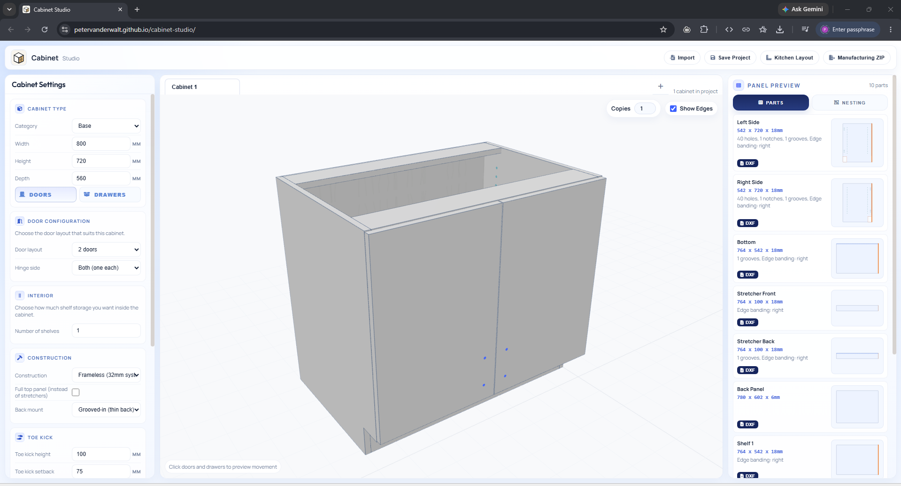

## Features

Planned enhancements and beta feedback are tracked in [TODO.md](TODO.md).

- Parametric cabinet dimensions for width, height, depth, materials, overlay, reveal, toe kick, and construction style.
- Door and drawer configurations with animated 3D preview.
- Shelf pin, hinge plate, drawer runner, and drawer slide reference hole generation.
- Panel preview sidebar with 2D previews for each generated part.
- Individual panel DXF export and full cabinet ZIP export.
- Local-only static app: no build step required.

## Cabinet Layouts

You can switch between open shelving, door-based cabinets, and drawer stacks without leaving the same design flow.

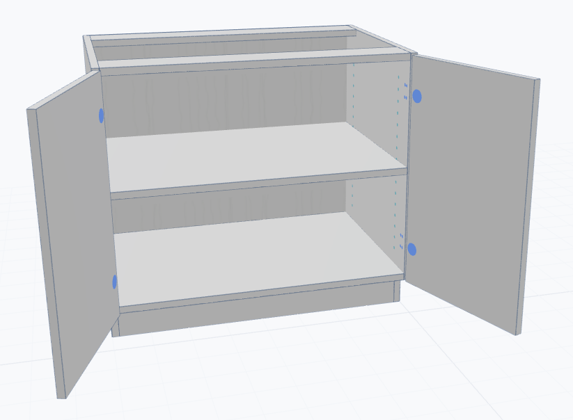
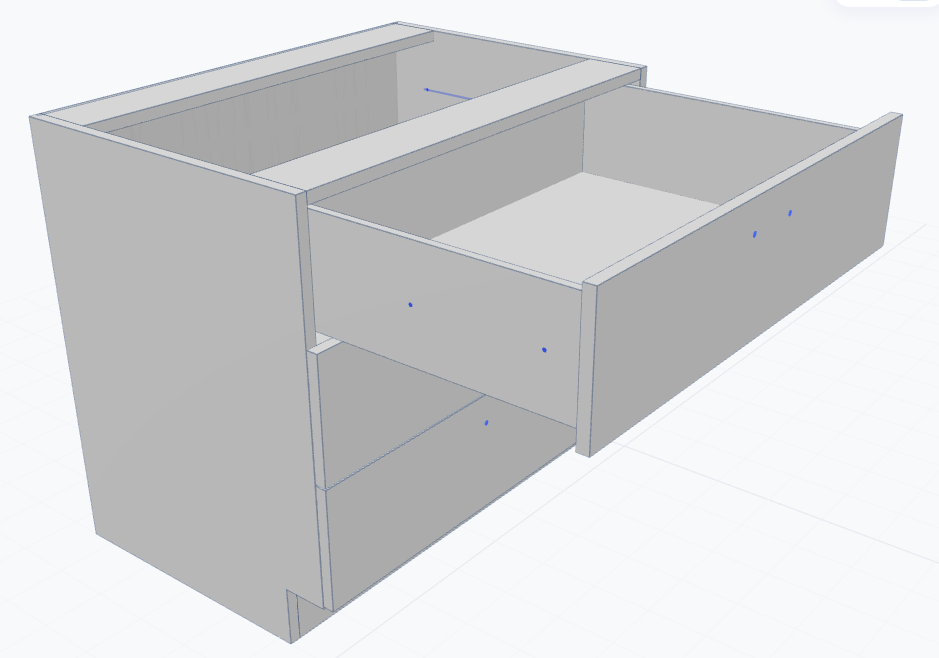

## Nesting And Materials

Material-aware nesting helps separate parts by sheet stock so machining output stays organized when a project uses more than one board type or thickness.

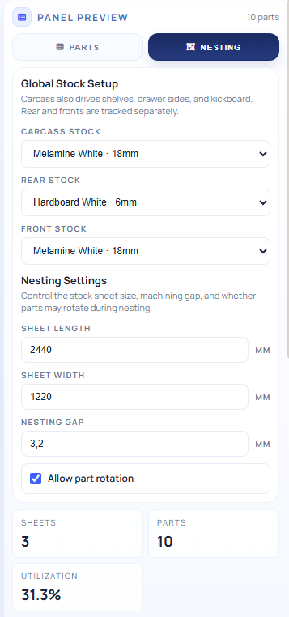
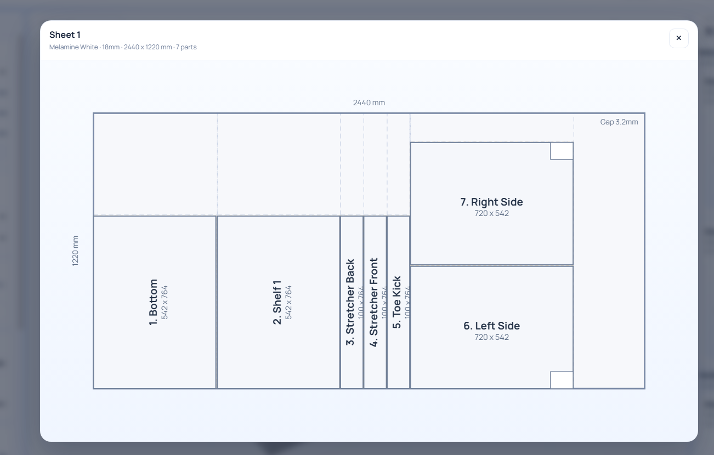

## Hardware Configuration

The **Hardware** library includes cup/plate patterns, 5 mm and ¼-inch shelf supports, metric/imperial pull centres, knobs, Accuride 3832E runner fit and matched carcass dowels. Presets retain custom overrides and saved-project dimensions. Pocket screws are a manual-jig assembly option.

Manufacturing ZIPs include hardware counts and a separate `machining-schedule.json` for mating face/edge operations. Explicit face/depth holes use separate DXF layers; edge bores require a separate setup and are never exported as face circles. Accuride fit does not generate mounting holes. Undermount and connector families are tracked for model-specific implementation.

See [hardware research, supported patterns and export setup](docs/hardware-library.md).

Pocketed connectors now include **Hettich Rastex 15 + Twister for 18 mm stock**, with cam pockets, bolt pilots and separate edge passages. The [connector guide](docs/pocket-connectors.md) includes supplier pictures and datasheets for Rastex, Minifix, Rafix, Cabineo and Clamex. Other connector families remain reference-only.

Large pull patterns move within the panel bounds with a notice; impossible patterns produce a warning. Click a part thumbnail to open a larger preview.

Joinery presets include supplier pictures for dowels, pocket screws and Cabineo, plus a dado illustration. **Through dados** extend the carcass bottom into both sides, while shelves remain adjustable on pins; their cut widths, 3D solids, nesting and DXFs include that engagement. **Cabineo 8 / 12 (surface mounted)** generate Lamello's overlapping housing bores and mating pilots. Nesting accounts for their open-edge machining. Other Cabineo mounting variants remain unsupported.

Hardware settings are configurable at project level, including drawer sliders, handles, and hinges, so drilling and clearances track the construction method you plan to build.

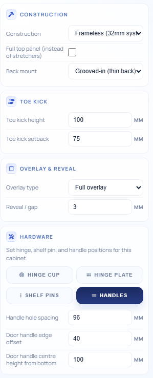

## Multi-Cabinet Projects

Larger jobs can be assembled as multi-cabinet projects, with copy counts for repeated units so one design can drive a full run of matching cabinets.

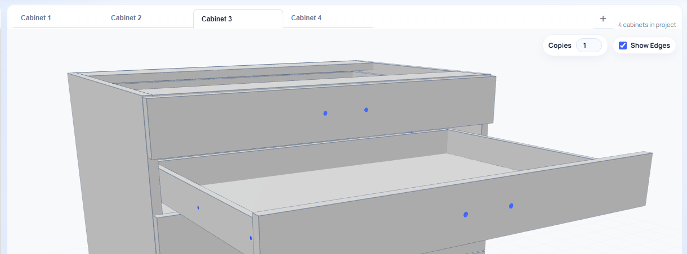

## Upcoming: Kitchen Layout Planning

An upcoming layout-planning view will extend Cabinet Studio from single-cabinet configuration into room-level arrangement, making it possible to place cabinets in a broader kitchen layout and render the overall plan before fabrication.

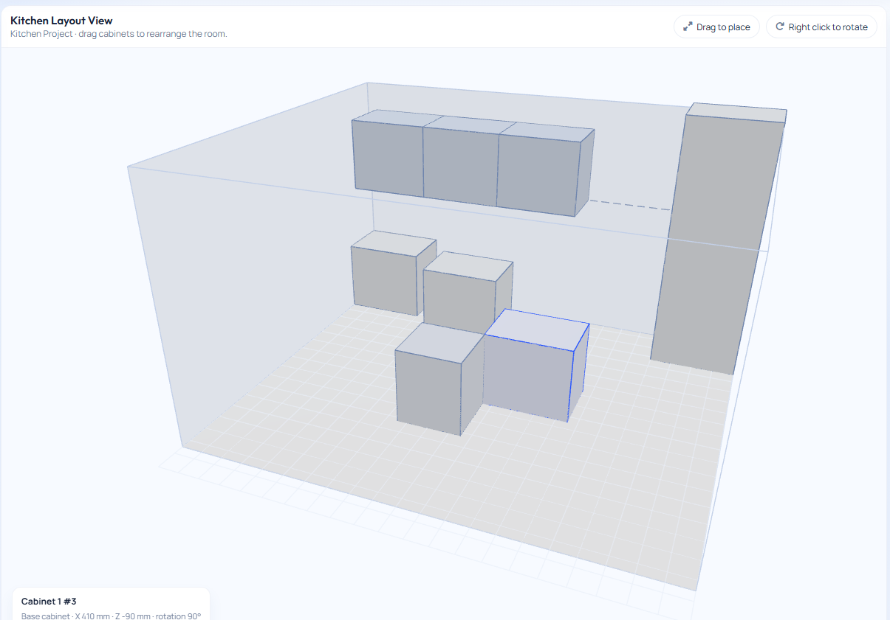

## Manufacturing Export

Cabinet Studio can export individual DXFs, nested DXFs, and a manufacturing ZIP bundle so the machining package is ready to hand off or archive as a single deliverable.

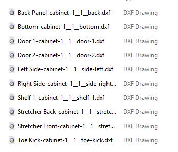
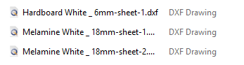
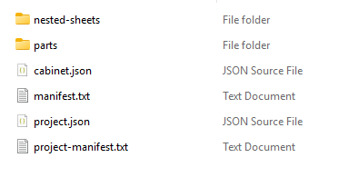

## Running Locally

Because the app uses ES modules, open it through a local web server rather than directly from the filesystem.

From this folder:

```powershell
python -m http.server 8080
```

Then open:

```text
http://127.0.0.1:8080/
```

The app loads Three.js from the import map in `index.html`, so an internet connection is currently required for the 3D viewer dependency.

## Project Structure

- `index.html`: App shell, styles, import map, and main layout.
- `assets/`: Cabinet Studio logo and favicon assets.
- `js/main.js`: App entry point, panel list rendering, import/export wiring.
- `js/cabinet-math.js`: Pure cabinet geometry and panel generation.
- `js/form-ui.js`: Cabinet settings form and configuration state.
- `js/three-viewport.js`: 3D preview rendering and animations.
- `js/dxf-writer.js`: DXF and ZIP export generation.
- `lib/jszip.min.js`: Local JSZip dependency for ZIP exports.

## Notes

Cabinet geometry is still evolving. Verify generated DXF drilling and panel dimensions against the intended hardware before cutting real material.

## Units and North American hardware

Choose **Metric (mm)** or **Imperial (inches)** in the top toolbar, immediately before Import. Inch inputs accept decimals, fractions (`3/4`), and mixed fractions (`23 3/4`). Switching units preserves the original geometry. Counts and angles retain their own units. The preference is saved with cabinets and shared with Kitchen Layout; layout dragging snaps to 1/16 inch in imperial mode.

Stock Setup includes nominal **3/4 inch (19.05 mm)**, **1/2 inch (12.7 mm)**, and **1/4 inch (6.35 mm)** plywood for carcass, rear, and fronts. These are exact nominal sizes; check the actual sheet thickness before machining.

Panel dimensions, nesting, manufacturing manifests, and DXF geometry use the selected units. DXFs declare inches or millimetres through `$INSUNITS`. Saved project JSON always stores dimensions in millimetres with a separate `units` preference, so older projects keep their scale.

Under **Hardware → Hinge Plate**, untick **Include second row** for two screws per plate; leave it ticked for the existing four-screw pattern. **Hinge plate pattern** offers **South Africa (2 × 2)** for the existing four-hole layout, **Blum frameless (2 × 1)** for one row 37 mm from the front with 32 mm vertical screw spacing, and **Other / Custom**. Dimensions remain editable; editing a dimension or the second-row checkbox selects Other / Custom. Choosing a pattern preserves door cup settings and other hardware dimensions.

North American hardware has no single universal drilling pattern. Blum's frameless cruciform plates include 37/32 patterns, while horizontal plates include 20/32 and COMPACT face-frame hinges have different attachment options. The preset applies to the named frameless pattern; use the exact hardware drawing for face-frame or other plates.

References:

- [Blum mounting plate catalogue: 20/32 and 37/32 patterns](https://publications.blum.com/2024/catalogue/en/150/)
- [Blum US CLIP top assembly and mounting plates](https://www.blum.com/us/en/products/hingesystems/clip-top/assembly/)
- [Blum US COMPACT face-frame attachment options](https://www.blum.com/us/en/products/hingesystems/compact/assembly/)

Run unit, stock, saved-project, mirrored hinge, and DXF scale checks with:

```powershell
node --experimental-default-type=module tests/units-and-hinges.mjs
```

## Grooved-in back fit

The grooved-in option uses rear-edge rebates on both sides, the bottom, and the top or rear stretcher. Rebate width follows the back thickness; engagement is 8 mm into the carcass, capped at half the carcass thickness for thin stock. The back finishes flush with the rear edge and engages equally on all four edges. Its width and height are the clear opening plus twice that engagement.

Shelves stop 2 mm before the back's inside face. Drawer boxes retain 20 mm clearance from that face, and runner reference positions follow the shortened drawer depth. Applied-rear dimensions retain their existing clearances. The 3D preview models the rebates as cutouts; DXF GROOVE outlines describe their footprint and the manufacturing manifest lists their depth into the inside face.

```powershell
node --experimental-default-type=module tests/grooved-back.mjs
```

## Drawer front Auto sizing

Drawer fronts size themselves after a 2-second pause in typing. Entering a height locks it (padlock icon); unlocked fronts (wand icon) share the remaining opening equally after reveal gaps. Clear a height or click its lock to return it to automatic sizing. Clicking the wand locks the current suggestion. A shrinking ring in each unlocked icon shows the countdown and restarts with each edit. Click any countdown ring to calculate immediately without locking the field. Locks are saved with the project and preserved across unit changes.

Changes to cabinet height, toe kick, reveal or drawer count also recalculate unlocked fronts. If all heights are locked and there is enough room for another front and reveal gap, the summary offers **Add another drawer**. This preserves existing heights and adds an unlocked drawer sized to the remainder. Otherwise the summary explains what to change without replacing entered heights.

```powershell
node --experimental-default-type=module tests/drawer-heights.mjs
```

## Stock material and thickness

Under **Nesting → Global Stock Setup**, every stock role has separate **Material**, **Colour**, and **Thickness** selections. All stock roles share the same material, colour and thickness options, including imported custom stock choices. The same combination can be selected for every part, and matching combinations nest together. Thickness lists contain both **Metric** (mm) and **Imperial** (fractional inch) groups, regardless of display units. This lets you mix, for example, 3/4-inch melamine carcass, 6 mm plywood back, and 1/2-inch plywood drawer sides. Changing material retains colour and thickness, and changing display units preserves all selections. Colour is part of stock identity: White and Storm Grey melamine nest separately at the same thickness. Panels retain structured material, colour and stock-key metadata; manifests and sheet DXF labels include the colour. Existing colour-bearing names migrate without changing thickness.

Carcass drives shelves and kickboard. Drawer side/back and bottom stocks are independent; their former thickness inputs are removed from Drawer Configuration. Existing project dimensions are preserved, including nonstandard thicknesses shown as an existing thickness option.

New imperial cabinets default to 3/4-inch melamine carcass/fronts, 1/4-inch plywood backs, 1/2-inch plywood drawer sides, and 96 × 48-inch nesting sheets. Presets calculate with the stated thickness, so verify actual material dimensions before machining.

Examples: [3/4-inch melamine](https://www.lowes.com/pd/White-Premium-Melamine-Panel-Common-34-in-x-48-in-x-96-in-Actual-0-75-in-x-49-in-x-97-in/3605068), [Columbia hardwood plywood sizes](https://www.columbiaforestproducts.com/app/uploads/2014/02/CFP101_HomeDepot_Special_Order_Plywoodweb.pdf), and [1/2-inch MDF](https://www.homedepot.com/p/202332602).

Each sheet card in **Nesting** has its own **DXF** button. The download contains that sheet’s nested parts, drilling, grooves and sheet outline in the selected units, using the same export as the manufacturing ZIP. Filenames include stock, thickness and sheet number.

Stock labels retain the thickness units selected for that stock (for example, 18 mm or 3/4 in), even when the workspace uses the other unit system. Other displayed dimensions use at most three decimals. Geometry and DXF coordinate calculations retain full precision.

### Routed door detail

In Door Configuration, choose a routed detail: rectangle, clipped corners, rounded corners, inward rounded corners, arched top or cathedral top. Plain remains the default. Set the centreline inset from the door edges and the corner size / arch rise. Details appear on the front face in the 3D preview and are saved with the cabinet.

Individual and nested DXFs include one closed centreline polyline per border detail on `DOOR_DETAIL`, separate from `CUTLINE`, `DRILL` and structural `GROOVE` geometry. Select this layer in CAM and route on the line with your chosen ballnose or V-bit and cutting depth. Curves use fine straight segments with approximately 0.02 mm chord tolerance. Corner sizes are limited to fit the door; an inset leaving no inner area produces no detail. Hinge bores are on the back face, while detail is on the front: plan machining setups accordingly.

For fake slats, select **Vertical slats (V-bit)** and set **Slat line spacing (centre to centre)**. The count is automatic, with exact spacing and equal side margins. The detail inset sets the minimum side margins and the top/bottom line ends. Panel entries show the resulting line count. Each groove exports as a separate open, two-point polyline on `DOOR_DETAIL`, including rotated nested parts, and appears in panel, nesting and 3D previews. Set V-bit and routing depth in CAM.
