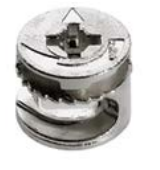
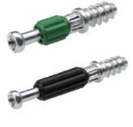
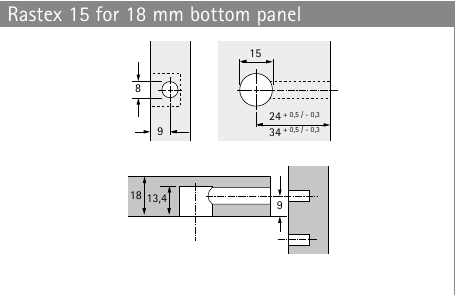
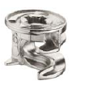
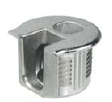
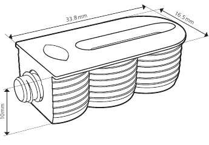

# Pocketed cabinet connectors

Supplier drawings reviewed 2026-10-22. The specified Rastex set and Cabineo 8/12 surface-mounted corner joints generate machining. Minifix, Rafix and Clamex remain references for subsequent presets.

## Hettich Rastex 15 + Twister: implemented

The **18 mm** preset pairs nickel-plated cam **13957** with **Twister DU 232 T bolt 9047861**. The supplier's drawing specifies a **15 mm** housing bore, **13.4 mm** depth, **9 mm** bolt axis, and **8 mm** edge passage. The selected bolt uses **34 mm** cam setback and a **5 mm × 11.5 mm** mating pilot. The passage is drilled to the cam centre, intentionally intersecting the housing bore.

[Supplier catalogue, printed pages 8, 10–11](https://web.hettich.com/fileadmin/media/Connecting_technology_2016_16359_HUS.pdf#page=10). [Current Hettich listing confirms cam 13957 for 18 mm panels](https://shop.hettich.com/ch_DE/Weitere-Produkte/Verbindungstechnik/Verbindungsbeschl%C3%A4ge-f%C3%BCr-Korpusse/Rastex-Exzenter-Verbindungsbeschlag/Rastex-15-ohne-Abdeckrand%2C-vernickelt%2C-18-mm/p/13957).

Cabinet Studio generates cam pockets, mating pilots and a separate edge schedule for bottom/top/stretchers. Cap tops put cams in the side panels and pilots underneath the top. Counts are complete cam/bolt sets. Other stock thicknesses are rejected; ¾ inch is 19.05 mm, not 18 mm. Positions remain editable. Trial assembly remains necessary.

## Häfele Minifix 15: next cam family

For example, **262.26.034** is the without-rim 18 mm variant: **15 mm** housing bore, **13.5 +0.5 mm** drilling depth and **9 mm** axis. The S100 bolt **262.28.928** specifies a 34 mm setback and 11 mm thread; other bolts require different edge passages or inserts. Do not substitute the Rastex depth or treat every Minifix 15 as the same fitting.

[Supplier catalogue: housings FF 2.13–2.14; bolts FF 2.17](https://hafelethailand.com/wp-content/uploads/2025/12/02-connector-technology-shelf-supports.pdf#page=14). Confirm the complete selected bolt/pilot installation before enabling machining.

## Häfele Rafix 20: an open-edge housing pocket

The supplier locates the **20 mm** pocket centre **9.5 mm** from the edge: the pocket therefore opens through that edge. Metal without-ridge housing **263.11.703** is for 16 mm stock with **12.7 +0.2 mm** depth; **263.11.705** is for 19 mm stock with **14.2 +0.2 mm** depth. The mating bolt axis follows half the panel thickness. Plastic, ridge and flush variants differ.

[Supplier catalogue FF 2.37](https://hafelethailand.com/wp-content/uploads/2025/12/02-connector-technology-shelf-supports.pdf#page=37). Reference only until a complete matching bolt/housing set is specified.

## Lamello Cabineo: surface-mounted 8 / 12 implemented

Lamello provides separate machining drawings for surface-mounted, flush and flush-cover-cap installation, including a three-15-mm-bore method and alternative router contours. The cover-cap recess is additional geometry. Cabineo 8, 12 and 8 M6 have different mating requirements; M6 needs a threaded counterpart or specified insert.

[Two-page supplier instructions; machining on page 2](https://lamello.com/fileadmin/products/Operating_instructions_Cabineo.pdf#page=2). Cabinet Studio implements surface-mounted drilling option 1: 3 × Ø15 mm, depth 11 mm, centres 3.6 / 14.8 / 26 mm from the joining edge; Ø5 mm mating pilot at 8 / 12 mm depth. The screw axis is 5 mm from the mounting face. The first housing bore opens 3.9 mm through the edge, so nesting keeps at least 7.8 mm between part outlines. Use boring operations, not individual circle profile cuts. Bottom/top/stretchers are supported, including reversed housing/pilot placement on a cap top. Flush, cover-cap, centre-panel and M6 variants are excluded. [Cabineo 8 M6 machining CAD reference](https://lamello.com/products/drilling-system/cabineo-8-m6).

## Lamello Clamex P-14 CNC: special undercut tooling

Clamex requires a P-System groove and access bore. It cannot be produced by a plain circular pocket. The manufacturer provides dedicated machining CAD for the CNC variant.

[Clamex P-14 CNC: manual and machining CAD](https://lamello.com/products/p-system/clamex-p-14-cnc). Reference only until the cutter, machine access and machining process are supported.

## In the app and exports

Under Hardware, choose the Rastex preset under **Carcass joinery**. Its supplier picture, datasheet and machining-diagram links appear underneath. **Connector pictures & datasheets** contains the reference families; these references do not enable unimplemented machining.

Pockets are circular bore outlines with explicit face/depth layers (for example `DRILL_TOP_D13.4MM`), not generated toolpaths. Use suitable boring/pocket operations in CAM. Edge passages remain in `machining-schedule.json`, never face-drill circles. Joint IDs pair the housing, passage and bolt pilot across project copies.

Images: [supplier credits and document checksums](../assets/hardware/SOURCES.md).
